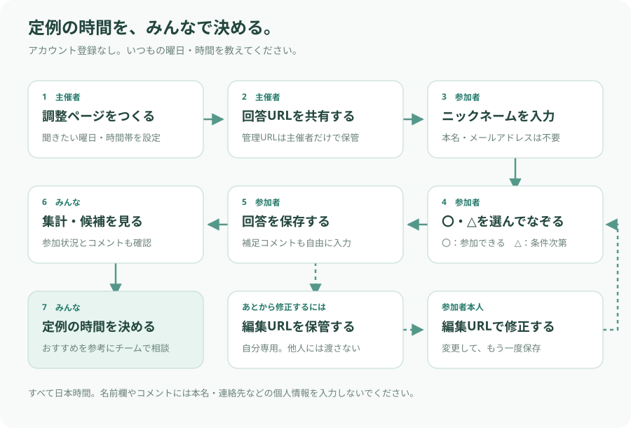

# ご都合うかがい君（仮）

チームの定例ミーティングを「いつもの何曜日・何時にするか」決めるための、シンプルな調整サイトです。
具体的な日付ではなく、普段参加しやすい曜日と時間帯を集めます。アカウント登録・ログイン・メールアドレスは不要です。

**[サイトを開く](https://gotsugou-ukagai-kun.mrkw.chatgpt.site/)**

## 利用の流れ



### 主催者

1. サイトでミーティング名と対象の曜日・時間帯を設定します。
2. 「調整ページをつくる」を押します。
3. 発行された回答URLを参加者へ共有します。管理URLは主催者だけで保管してください。
4. 集計URLでおすすめ候補を確認し、チームで開催時間を決めます。

### 参加者

1. 回答URLを開き、ニックネームを入力します。
2. 「〇 参加できる」または「△ 条件次第」を選び、時間帯をなぞります。
3. 必要なら補足コメントを入力し、「回答を保存する」を押します。
4. 保存後に表示される、自分専用の編集URLを保管します。

PCではマウスを押したままドラッグ、スマートフォンでは指でなぞって連続入力できます。
同じ状態のマスをもう一度なぞると解除できます。「消す」でも解除できます。
スクロールは表の外側で行ってください。キーボードではTabとSpaceでも入力できます。

## 回答の意味

| 状態 | 意味 |
| --- | --- |
| 〇 | 定例として設定されても参加できる |
| △ | 条件次第で参加できる。条件はコメントに補足できる |
| 未選択 | 参加不可として集計する |

コメントは回答全体に付けられる任意の補足で、500文字まで入力できます。曜日に限らず、隔週であれば参加可能などの条件を書けます。

## 初期設定と集計

- 月〜金：18:00〜22:00、30分刻み。
- 土・日・祝はそれぞれ追加可能。初期の時間帯は8:00〜22:00です。
- 作成時に曜日、開始・終了時刻、30分または60分の枠を変更できます。
- 表の左右に時刻、上下に曜日を表示します。表示時刻はすべて日本時間です。
- 祝日の列を使う場合、月〜日は祝日以外の通常の都合として回答してください。
- 参加者は各自の回答で追加されます。人数の事前登録は不要です。
- ヒートマップの色は〇の人数を表し、各マスに〇と△の人数を表示します。
- おすすめは〇が多い順、同数なら△が多い順。同率は同じ順位で表示します。
- 全員が〇の候補を強調し、△のみの候補も表示します。順位は開催時間の自動決定ではなく、相談のための目安です。
- 候補を押すと、〇・△・未選択のメンバーと各自のコメントを確認できます。

## URLの使い分け

| URL | 用途 | 保管・共有先 |
| --- | --- | --- |
| 回答URL | 新しい回答を入力する | チームへ共有 |
| 集計URL | 回答状況とおすすめを確認する | チームへ共有 |
| 管理URL | 設定変更・回答者削除・ページ削除 | 主催者だけで保管 |
| 編集URL | 自分の回答・コメントを修正する | 回答者本人だけで保管 |

管理・編集URLには推測しにくいランダムなキーが含まれます。そのURLを知る人は変更できるため、ほかの人に渡さないでください。
紛失したURLの再発行機能はありません。回答開始後は曜日・時間枠を変更できないため、枠を変える場合は新しい調整ページを作成してください。

## 個人情報について

このサイトは、ミーティングの都合確認・調整のためだけに使ってください。
**ニックネームで回答し、本名・連絡先などの個人情報を名前欄やコメントに入力しないでください。**
回答・集計URLを知っている人は、ニックネーム・時間帯の回答・コメントを閲覧できます。

## ソースと公開の管理

このGitHubリポジトリはソースと変更履歴の保存先です。公開はSitesで行い、回答はCloudflare D1の共有DBに保存します。
ソースと回答データは別管理です。GitHubには回答DB、編集・管理キー、認証情報、ローカルのテスト回答を送信しません。

ローカルのGit送信先は `github`、ブランチは `main` です。更新時は検証済みのソースをSitesとGitHubへ同期し、Sitesの保存済みバージョンを公開します。
GitHubへの送信による自動公開は設定していません。回答DBのバックアップ・復元手順は未整備です。

## 開発・検証する方へ

構成はReact / TypeScript / Vinext、Cloudflare Workers、Cloudflare D1 / Drizzleです。Node.jsは `>=22.13.0` を使用します。

```sh
npm run install:ci
npm run build
npm run start -- --port 5173
```

初めてローカルDBを準備する場合は、ビルド後に初期SQLを一度だけ適用します。既存のDBに再適用しないでください。
この操作はローカルの検証用DBだけを対象とします。

```sh
node --import ./scripts/sites-env.mjs ./node_modules/wrangler/bin/wrangler.js d1 execute DB --local --config dist/server/wrangler.json --persist-to .wrangler/state --file drizzle/0000_black_hairball.sql
```

型チェックと集計・入力のテスト：

```sh
npx tsc --noEmit
node --experimental-strip-types --test tests/schedule.test.mjs
```

ローカルサーバーを起動した状態で、保存・再編集などのAPIテストを実行できます。このテストはローカルDBに架空の回答を作成します。

```sh
node --experimental-strip-types --test tests/api.test.mjs
```

### 主なファイル

| ファイル | 内容 |
| --- | --- |
| `app/meeting-app.tsx` | 作成・回答・集計・管理画面、ドラッグ操作 |
| `app/globals.css` | 画面と表のデザイン、スマートフォン対応 |
| `app/api/[...path]/route.ts` | 回答の保存・復元、入力と編集権限の検証 |
| `lib/schedule.ts` | 曜日・時間枠、〇・△の集計、旧回答の読み込み |
| `db/schema.ts` / `drizzle/` | DB構造と初期SQL |
| `.openai/hosting.json` | Sitesの識別子と保存先の設定 |
| `tests/` | 集計・入力・保存の自動テスト |

既存の選択済み回答は〇として読み込みます。編集・管理キーはDBにハッシュで保存し、集計APIには返しません。
Sitesで公開する際は、Sitesプラグインの手順に従ってビルド・ソース送信・バージョン保存・公開を行ってください。
